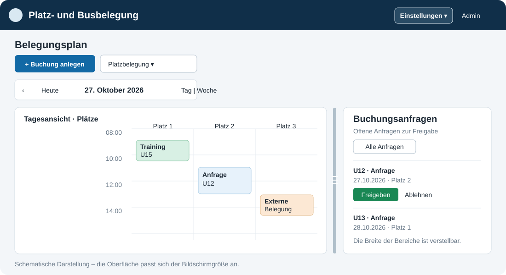
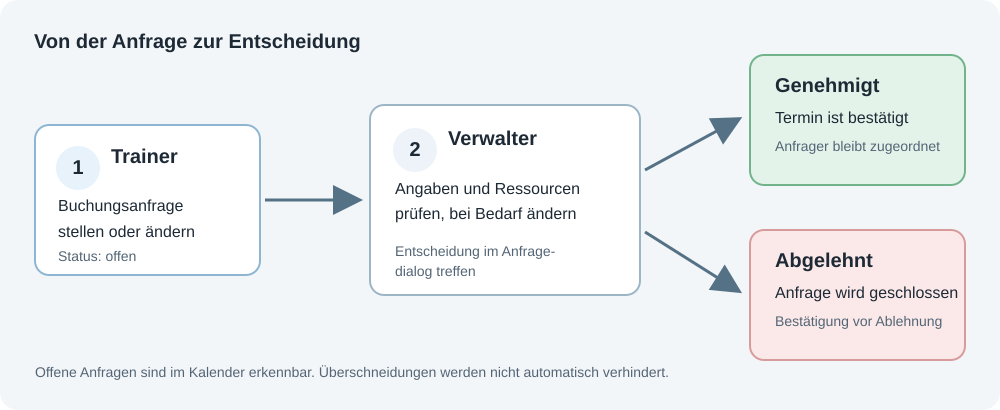
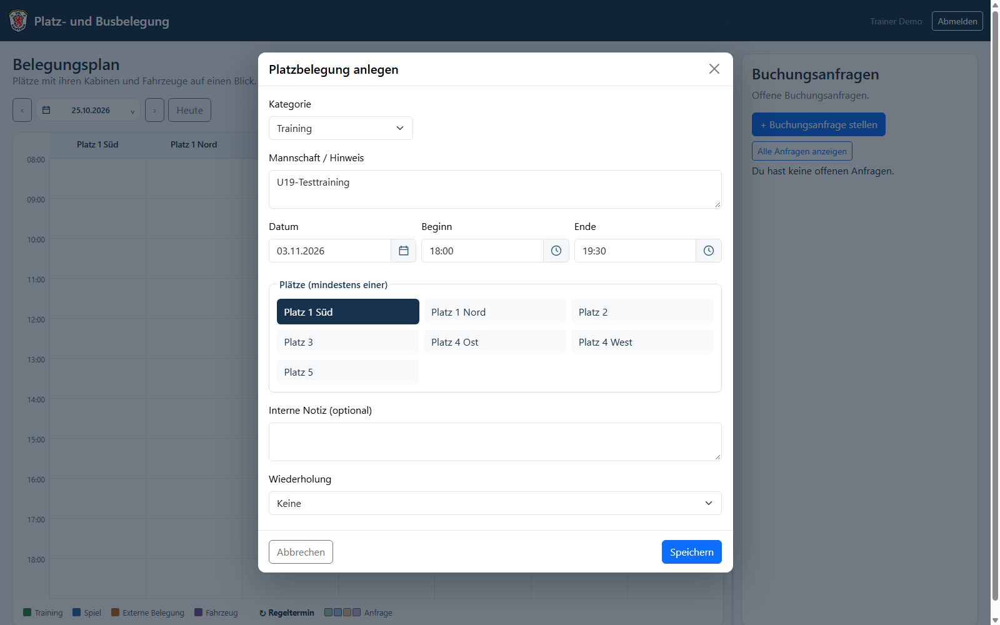
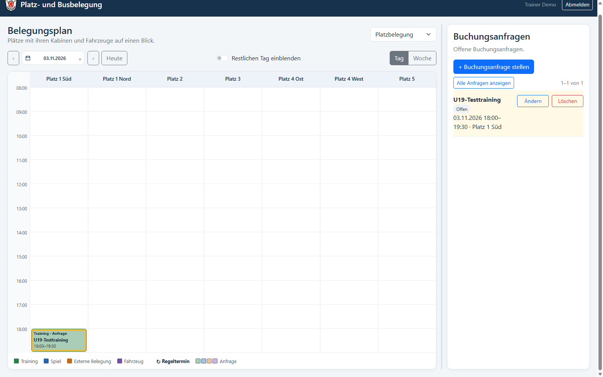
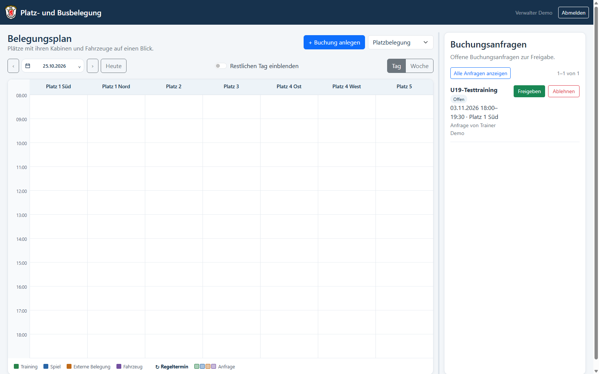
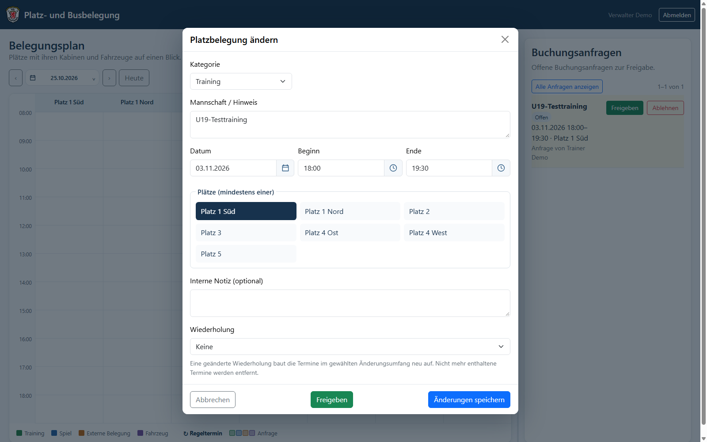
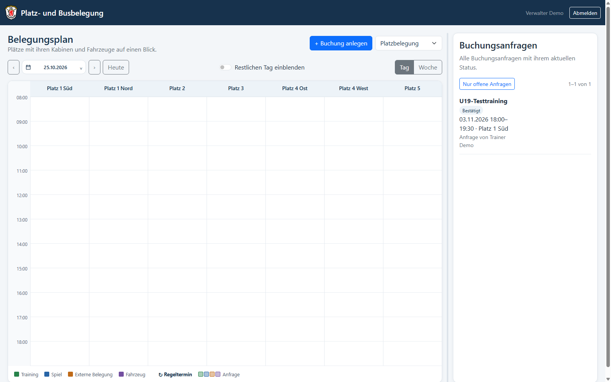
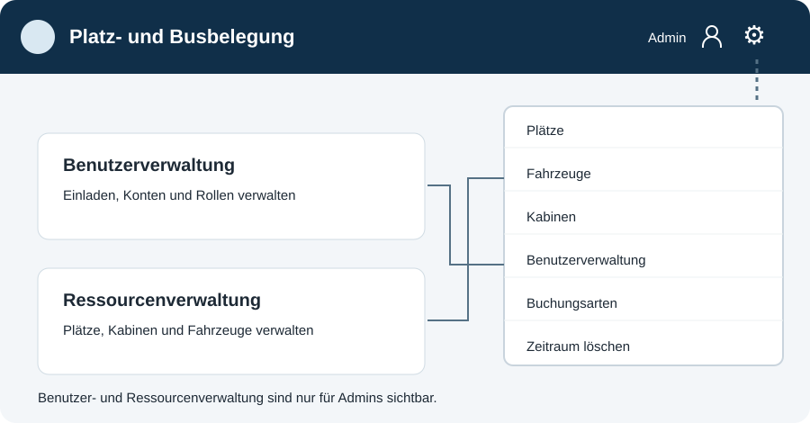

# Bedienungsanleitung: Platz- und Busbelegung

Diese Anleitung erklärt, wie der Belegungsplan im Alltag verwendet wird – vom Finden eines Termins über eine Buchungsanfrage bis zur Verwaltung von Benutzern und Ressourcen.

## Kapitel 1: Einführung und Motivation

Plätze, Kabinen und Fahrzeuge werden von mehreren Mannschaften und Verantwortlichen genutzt. Ein gemeinsamer Kalender macht Belegungen und offene Anfragen sichtbar und schafft einen einheitlichen Ablauf für Planung und Freigabe. Trainer können Termine anfragen, Verwalter können diese prüfen und genehmigen, und Admins verwalten zusätzlich Benutzer und Ressourcen.

Der Kalender ist eine Übersicht, keine automatische Konfliktprüfung: Zeitliche Überschneidungen sind möglich. Bitte prüfe vor dem Speichern die angezeigten Zeiten und Ressourcen.

Die Diagramme in dieser Anleitung sind **schematische Darstellungen**. Die Screenshots zum Anfrage- und Freigabeablauf zeigen die aktuelle Oberfläche mit fiktiven Demo-Daten; sie enthalten keine echten Buchungen oder Benutzerkonten. Beschriftungen oder Anordnungen können sich je nach Bildschirmgröße leicht unterscheiden.

## Inhaltsverzeichnis

1. Einführung und Motivation
2. Rollen und öffentliche Ansicht
3. Kalender bedienen
4. Buchungsanfrage stellen
5. Anfrage durch Verwalter prüfen und freigeben
6. Eigene Anfrage verwalten
7. Bestätigte Buchungen verwalten
8. Einstellungen für Admins
9. Häufige Fragen

## Kapitel 2: Rollen und öffentliche Ansicht

### Rollen im Überblick

| Rolle | Was du tun kannst |
|---|---|
| Öffentliche Besucher | Bestätigte Belegungen und offene Anfragen im Kalender ansehen. |
| Trainer | Platz- und Fahrzeuganfragen stellen sowie eigene offene Anfragen ändern oder löschen. |
| Verwalter | Buchungen direkt anlegen, Anfragen prüfen, genehmigen oder ablehnen und bestätigte Buchungen bearbeiten oder löschen. |
| Admin | Alle Verwalterfunktionen sowie Benutzer und Ressourcen verwalten. |

Die öffentliche Ansicht zeigt keine internen Notizen. Angemeldete Benutzer einschließlich Trainer sehen sie im Kalender und in den Buchungsdetails.

### Öffentliche Ansicht (ohne Anmeldung)

Über **Anmelden → Registrieren** kannst du ein Konto beantragen. Aktive Admins mit E-Mail-Adresse werden über deine Anfrage benachrichtigt. Der Link in der Benachrichtigung führt gegebenenfalls nach der Anmeldung zur Registrierungsübersicht, die nur für Verwalter und Admins zugänglich ist. Die Rolle wird erst bei der Freigabe vergeben. Nach Freigabe durch einen Verwalter oder Admin erhältst du einen Einladungslink per E-Mail, über den du dein Passwort festlegst. Erst danach ist die Anmeldung möglich. Verwalter finden offene Registrierungen im Benutzermenü, Admins unter **Einstellungen → Registrierungen**. Bei der Freigabe kann die Rolle bis zur eigenen Rolle gewählt werden; Admins dürfen auch Admin vergeben. Bei Ablehnung erhältst du eine E-Mail und die Anfrage wird entfernt. Schlägt der Versand fehl, bleibt die Anfrage zur erneuten Bearbeitung offen.

Ist eine E-Mail-Adresse oder ein Benutzername bereits vergeben, bleiben die Angaben im Formular erhalten. Für einen bereits verwendeten Benutzernamen werden auswählbare freie Vorschläge angezeigt; ihre Verfügbarkeit wird beim erneuten Absenden geprüft.

In der Registrierungsübersicht stehen alle offenen Anfragen in einer gemeinsamen Tabelle. Die Auswahl der Benutzerrolle und die Aktionen zur Freigabe oder Ablehnung stehen in eigenen Spalten derselben Zeile. Auf schmalen Bildschirmen lässt sich die Tabelle seitlich scrollen.

Beim Einrichten des Kontos über den Einladungslink gibst du das neue Passwort zweimal ein. Beide Eingaben müssen übereinstimmen.

Der Belegungsplan kann ohne Benutzerkonto geöffnet werden. Öffentliche Besucher können zwischen **Platzbelegung** und **Fahrzeugkalender** wechseln, den Zeitraum und die Tages- oder Wochenansicht auswählen und Kalendereinträge anklicken, um deren Details anzusehen.

Im Kalender erscheinen bestätigte Buchungen und offene Anfragen. Offene Anfragen sind als **Anfrage** gekennzeichnet und heller dargestellt, erhalten aber keinen Legendeneintrag. Die Legende erklärt die Buchungskategorien bzw. Fahrzeuge sowie das Symbol **↻ Regeltermin**. Der Kalender nutzt die verbleibende Fensterhöhe bis zum unteren Seitenabstand; eine kleinere oder umgebrochene Legende wird dabei automatisch berücksichtigt. In den Details werden öffentliche Angaben wie **Gebuchte Plätze**, Kategorie und Zeitraum angezeigt. Ein separates Feld „Ressource“ entfällt. Interne Notizen bleiben verborgen.

Die öffentliche Ansicht ist schreibgeschützt: Es gibt dort keine Anfrageübersicht und keine Möglichkeit, Buchungen anzulegen, zu ändern, freizugeben oder zu löschen. Dafür ist eine Anmeldung mit den passenden Berechtigungen erforderlich.

## Kapitel 3: Kalender bedienen

### Kalenderübersicht

### Kalender auswählen und navigieren

- Im Burger-Menü wechselst du zwischen **Platzbelegung**, **Kabinenbelegung** und **Fahrzeugkalender**. Nach einer Auswahl schließt sich das Menü automatisch. Direkte Links zu den Ansichten stehen in der [README](../../README.md#direktlinks-zu-den-belegungsansichten).
- Ein Klick auf das Vereinslogo oder den Anwendungsnamen führt jederzeit zur Platzbelegung zurück.
- Im selben Menü wählst du auf Handy und Desktop per Radiobutton zwischen **Tag** und **Woche**. **Ganzen Tag anzeigen** bleibt eine Checkbox und ist nur in der Tagesansicht aktiv.
- Angemeldet öffnet der separate **+**-Button die Auswahl für neue Platz- oder Fahrzeugeinträge. Trainer stellen darüber Buchungsanfragen, Verwalter und Admins legen Buchungen an.
- Angemeldet öffnet ein Klick auf das Kopfsymbol neben deinem Namen das Benutzermenü mit **Mein Profil** und **Abmelden**. Admins sehen daneben ein Zahnrad für die **Einstellungen** mit den Verwaltungsfunktionen. Ohne Anmeldung steht nur **Anmelden** zur Verfügung.
- Mit den Pfeilen oder einer horizontalen Wischgeste im Kalender wechselst du zum vorherigen oder nächsten Zeitraum. In der Tagesansicht wechselst du dabei um einen Tag, in der Wochenansicht um eine Woche. **Heute** springt zum aktuellen Datum; das Datum selbst öffnet die Datumsauswahl.
- Das Datumsfeld ist kompakt, behält für Tages- und Wochenwerte dieselbe Breite und ist genauso hoch wie die benachbarten Pfeilbuttons.
- **Tag** zeigt einen Tagesplan, **Woche** eine Wochenübersicht.
- Im Tagesplan bleibt „Platz 5“ einzeilig lesbar. Zusätze wie „Süd“, „West“ oder „Nord“ stehen in einer zweiten Überschriftszeile. Die Platz- und Kabinenbelegung verwenden in Tages- und Wochenansicht kompaktere Spalten; bei ausreichend Platz füllen sie weiterhin die gesamte verfügbare Breite aus. Auf schmalen Bildschirmen lassen sich die Spalten horizontal scrollen. Eine neue Wischgeste am rechten Scrollrand nach links wechselt zum nächsten Zeitraum; am linken Scrollrand nach rechts zum vorherigen Zeitraum. Eine Geste, die erst beim Scrollen den Rand erreicht, wechselt noch nicht den Zeitraum.
- Erreicht der Kalender beim vertikalen Scrollen sein Ende, setzt sich dieselbe Wisch- oder Mausradbewegung unmittelbar auf der Seite fort, beispielsweise zu den Buchungsanfragen unter dem Kalender. Das gilt auch nach mehreren Wischbewegungen durch den Kalender; eine zusätzliche Seitenanimation verzögert den Übergang nicht. Du musst dafür weder neu ansetzen noch den Zeiger aus dem Kalender bewegen. Beim Zurückscrollen wird zuerst der Kalender wieder vollständig sichtbar, danach scrollt sein Inhalt nach oben. Schnelle Wischgesten laufen nach dem Loslassen weiter.
- Der Schalter **Ganzen Tag anzeigen** zeigt bei Bedarf Zeiten außerhalb des Standardbereichs von 09:00 bis 21:00 Uhr. Die Stundenzeilen sind für eine kompaktere Darstellung um 20 % verkleinert.
- Ein Klick auf einen Kalendereintrag öffnet die Details. Dort siehst du unter anderem Kategorie, Ressourcen, Beginn, Ende, Wiederholung und – falls vorhanden – zugeordnete Kabinen.

Offene Anfragen sind im Kalender zusätzlich als **Anfrage** gekennzeichnet und heller dargestellt. Überlappende Buchungen können nebeneinander erscheinen.

Bei schmalen oder flachen Kalendereinträgen werden Kategorie und Serienkennzeichnung ausgeblendet, damit mehr Platz für die übrigen Buchungsangaben bleibt. Bei mehr Platz erscheinen sie wieder. Im Tooltip und in den Buchungsdetails bleiben Kategorie und Serieninformation verfügbar.

### Anfrageübersicht anpassen

Die Anfrageübersicht befindet sich neben dem Kalender. Ziehe den Trenner zwischen beiden Bereichen, um die Breite zu ändern. Alternativ kannst du den Trenner mit den Pfeiltasten bedienen. Die Breite und die Auswahl zwischen Platz- und Fahrzeugkalender bleiben im aktuellen Browserfenster auch nach dem Neuladen erhalten.

## Kapitel 4: Buchungsanfrage stellen

Trainer erstellen eine **Anfrage**. Verwalter und Admins können eine Buchung direkt anlegen und bestätigen.

1. Öffne den **+**-Button rechts oben am Belegungsplan. Trainer stellen damit eine Buchungsanfrage, Verwalter und Admins legen eine Buchung an.
2. Wähle **Platzbelegung** oder **Fahrzeug**.
3. Fülle die Angaben aus und speichere.

### Anfrage absenden

Als Trainer prüfst du im Dialog Kategorie, Mannschaft oder Hinweis, Datum, Uhrzeiten und Ressource. Mit **Speichern** sendest du die Anfrage ab. Sie erscheint danach in deiner Übersicht als **Offen** und ist im Kalender als Anfrage markiert.

*Abbildung: Beispiel für eine ausgefüllte Trainingsanfrage vor dem Absenden.*

*Abbildung: Nach dem Absenden erscheint die Anfrage in der Liste und im Kalender.*

### 4.1 Angaben bei einer Platzbelegung

- Wähle eine Kategorie: **Training** oder **Spiel**. Verwalter und Admins können außerdem **Extern** auswählen.
- **Mannschaft / Hinweis** ist erforderlich.
- Wähle ein Datum, Beginn und Ende. Neue Buchungen starten mit 90 Minuten Dauer. Platzbuchungen müssen am selben Tag enden.
- Wähle mindestens einen Platz. Verwalter und Admins können zusätzlich Kabinen für den gesamten Buchungstermin zuordnen. Traineranfragen können keine Kabinen belegen.
- Optional kannst du eine interne Notiz ergänzen. Sie ist nicht öffentlich sichtbar.

### 4.2 Angaben bei einer Fahrzeugbuchung

Wähle das Fahrzeug und gib **Mannschaft / Hinweis** und den Zeitraum ein. Die bisherigen Felder Ziel, Zweck und Fahrer entfallen. Interne Notizen sind nur für Verwalter und Admins sichtbar.

### 4.3 Wiederholungen

Bei einer Platzbelegung kannst du eine Wiederholung festlegen: täglich, wöchentlich, monatlich oder jährlich. Daneben bestimmst du das Intervall, beispielsweise alle zwei Wochen; bei wöchentlicher Wiederholung erscheint anschließend der Wochentag des ausgewählten Datums. In der nächsten Zeile wählst du, ob die Serie an einem Enddatum oder nach einer Anzahl von Terminen endet. Bei älteren Serien mit mehreren Wochentagen bleiben diese erhalten, solange die Wiederholungsregel nicht geändert wird. Eine Serie ist auf höchstens 5.000 Termine begrenzt.

## Kapitel 5: Anfrage durch Verwalter prüfen und freigeben

1. Öffne in der Anfrageübersicht den offenen Eintrag. Der Eintrag zeigt **Freigeben** und **Ablehnen**.
2. Prüfe die Angaben im Buchungsdialog und passe sie bei Bedarf an. Bei Platzanfragen kannst du optional Kabinen auswählen; diese werden erst beim Freigeben zugeordnet.
3. Wähle **Freigeben**, um die Anfrage mit den angezeigten Angaben zu bestätigen.

*Abbildung: Der Verwalter findet offene Anfragen in der Anfrageübersicht und kann sie dort öffnen oder direkt ablehnen.*

*Abbildung: Vor der Freigabe können die Angaben geprüft werden. Bei Bedarf lassen sie sich hier ändern.*

Bei Anfragen mit mehreren Plätzen betrifft die Freigabe alle noch offenen Platzzuordnungen. Serien erscheinen als ein Eintrag mit Anzahl und Zeitraum. Änderungen, Freigabe, Ablehnung und Löschen betreffen alle noch offenen Termine der Serie, auch ältere; bereits entschiedene Termine bleiben unverändert.

Du kannst eine offene Anfrage auch im Kalender öffnen und dort **Freigeben** wählen. Es erscheint derselbe Buchungsdialog wie in der Anfrageübersicht. Änderungen und Freigabe betreffen hier nur den ausgewählten Termin mit allen noch offenen Ressourcenzuordnungen; bei Platzanfragen lassen sich optional Kabinen ergänzen.

Nach der Freigabe verschwindet der Eintrag aus der Liste der offenen Anfragen. Über **Alle Anfragen anzeigen** lässt sich der neue Status **Bestätigt** aufrufen.

*Abbildung: In der vollständigen Anfragenliste ist die genehmigte Anfrage als bestätigt gekennzeichnet.*

Mit **Ablehnen** lehnst du eine Anfrage ab. Die Anwendung fragt vorher in einem eigenen Dialog nach einer Bestätigung. Direkt von Verwaltern oder Admins angelegte Buchungen erscheinen nicht in der Anfrageübersicht; sie sind weiterhin im Kalender sichtbar.

## Kapitel 6: Eigene Anfrage verwalten

Die Anfrageübersicht zeigt standardmäßig deine offenen Anfragen. Wähle **Ändern**, um eine offene Anfrage im Buchungsdialog zu bearbeiten, oder **Löschen**, um sie zurückzuziehen. Vor dem Löschen erscheint eine Bestätigungsabfrage. Gelöschte offene Anfragen werden dauerhaft entfernt.

Mit **Alle Anfragen anzeigen** kannst du zusätzlich abgeschlossene Anfragen ansehen. Anfragen, deren Termine mehr als drei Monate zurückliegen, werden nicht angezeigt. Längere Listen sind seitenweise mit jeweils zehn Einträgen organisiert.

## Kapitel 7: Bestätigte Buchungen verwalten

Verwalter und Admins können einen bestätigten Kalendereintrag öffnen und bearbeiten. Bei Serienterminen fragt die Anwendung, ob die Aktion nur diesen Termin oder diesen und alle zukünftigen Termine betrifft. Prüfe den gewählten Umfang vor dem Speichern.

Nach erfolgreichem **Speichern** schließt sich der Bearbeitungsdialog automatisch und die Übersicht wird aktualisiert. Bei einem Speicherfehler bleibt der Dialog mit einer Fehlermeldung geöffnet, damit du die Angaben korrigieren kannst.

Zum Löschen wählst du im Termindialog **Löschen**. Bei Serienterminen wird zuerst der Umfang abgefragt, danach erscheint eine eigene Bestätigungsabfrage. Kabinen lassen sich ebenfalls aus der Buchung entfernen. Wird der letzte Platz eines Termins gelöscht, wird der Termin samt seinen Kabinenzuordnungen entfernt.

Admins können über **Einstellungen → Zeitraum löschen** alle Termine, nur bestätigte Buchungen oder nur offene Anfragen löschen. Maßgeblich ist der Beginn des Termins zwischen dem Von- und Bis-Datum, einschließlich beider Tage. Die Auswahl gilt für Plätze und Fahrzeuge. Bei gemischten Anfragen bleiben nicht ausgewählte Platzzuordnungen erhalten. Serientermine außerhalb des Zeitraums werden nicht verändert. Vor der endgültigen Löschung sind zwei Bestätigungen erforderlich. Die Löschung ist dauerhaft und versendet keine E-Mails.

## Kapitel 8: Einstellungen für Admins

Admins öffnen über das **Zahnrad neben ihrem Namen** die Einstellungen und wählen dort **Plätze**, **Fahrzeuge**, **Kabinen**, **Benutzerverwaltung**, **Buchungsarten** oder **Zeitraum löschen**. **Mein Profil** und **Abmelden** stehen allen angemeldeten Benutzern im separaten Menü unter dem Kopfsymbol zur Verfügung.

### Benutzerverwaltung

- Benutzer per E-Mail einladen oder ohne E-Mail-Adresse anlegen.
- Beim Einladen und Anlegen werden Vor- und Nachname getrennt erfasst.
- Rollen und Kontostatus verwalten und Passwörter ändern.
- Beim Löschen eines Benutzers bleiben Buchungen und Buchungshistorie erhalten; die Zuordnung zum gelöschten Konto entfällt.

Der letzte aktive Admin kann nicht gelöscht werden.

Links in E-Mails sind fünf Tage gültig. Links in Buchungsbenachrichtigungen melden dich mit dem Konto an, an das die E-Mail geschickt wurde – auch wenn im Browser gerade ein anderes Konto aktiv ist. Diese persönlichen Links dürfen nicht weitergeleitet werden. Links in Registrierungsbenachrichtigungen melden nicht automatisch an; die Anmeldung erfolgt wie gewohnt. Bei einem gültigen Einladungs- oder Passwort-Reset-Link wird das bisherige Konto zuerst abgemeldet. Sobald du das neue Passwort erfolgreich gespeichert hast, bist du automatisch im zugehörigen Empfängerkonto angemeldet. Ungültige oder abgelaufene Links wechseln das Konto nicht. Bereits ausgestellte Links behalten ihre bisherige Ablaufzeit.

Beim Zurücksetzen gibst du das neue Passwort zweimal ein. Nur wenn beide Eingaben übereinstimmen, wird es gespeichert. Der Reset-Link ist einmal verwendbar.

E-Mails zeigen ein Symbol für ihren Anlass. Buchungsbenachrichtigungen enthalten verfügbare Angaben zum Termin, zu Ressourcen, Kabinen und Wiederholungen sowie interne Notizen für berechtigte angemeldete Empfänger. Bei Änderungen einzelner Ressourcen oder Kabinen nennen sie die betroffene Zuordnung. Bei Regelterminen kann der angezeigte Termin für mehrere betroffene Termine stehen.

Jeder angemeldete Benutzer kann über **Mein Profil** den eigenen Vor- und Nachnamen sowie die E-Mail-Adresse bearbeiten. Der Nachname ist optional. Der Benutzername wird dort angezeigt, kann aber nicht selbst geändert werden. **Abbrechen** führt ohne Speichern zurück zum Belegungsplan.

### Ressourcenverwaltung

- Die Einstellungen enthalten für Plätze, Fahrzeuge und Kabinen jeweils einen eigenen Menüpunkt. Über **+** legst du eine Ressource in der ausgewählten Kategorie an; bestehende Ressourcen kannst du umbenennen, deaktivieren oder wieder aktivieren.
- Ressourcen innerhalb ihrer Kategorie per Drag-and-drop sortieren. Der gesamte umrandete Kategorieabschnitt ist ein gültiger Ablagebereich; außerhalb wird die Änderung verworfen. Der Sortiergriff kann auch mit den Pfeiltasten bedient werden.
- Beim Löschen einer Ressource werden auch Buchungen entfernt, die sie verwenden. Prüfe deshalb vor dem Löschen, ob die Ressource noch benötigt wird.

Der Ressourcentyp einer bereits verwendeten Ressource kann nicht geändert werden.

## Kapitel 9: Häufige Fragen

**Warum sehe ich meine Anfrage nicht?**  
Prüfe, ob du angemeldet bist und ob **Alle Anfragen anzeigen** ausgewählt ist. Termine, die mehr als drei Monate zurückliegen, werden aus der Anfrageübersicht ausgeblendet.

**Warum sehe ich eine direkt angelegte Buchung nicht in „Alle Anfragen“?**  
Die Liste enthält Anfragen. Direkt angelegte Buchungen von Verwaltern und Admins erscheinen dort nicht, bleiben aber im Kalender sichtbar.

**Warum kann ich keine Kabine auswählen?**  
Kabinen können nur Verwalter und Admins einer Platzbuchung zuordnen. Traineranfragen können keine Kabinen belegen. Die Kabinenbelegung ist für alle im Kalender einsehbar.

**Verhindert der Kalender Überschneidungen?**  
Nein. Zeitliche Überschneidungen sind möglich. Prüfe daher vor dem Speichern die Belegung und die ausgewählten Ressourcen.

**Wer sieht interne Notizen?**
Alle angemeldeten Benutzer sehen sie im Kalender und in den Buchungsdetails. Öffentliche Kalenderansichten geben diese Angaben nicht aus.
