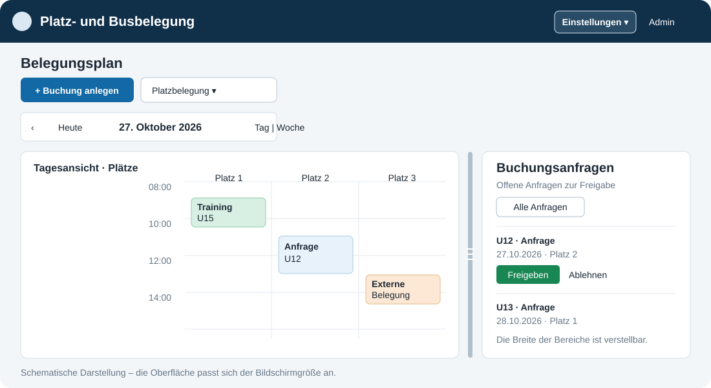
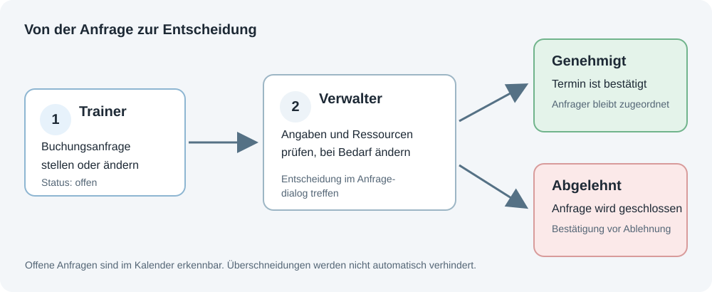
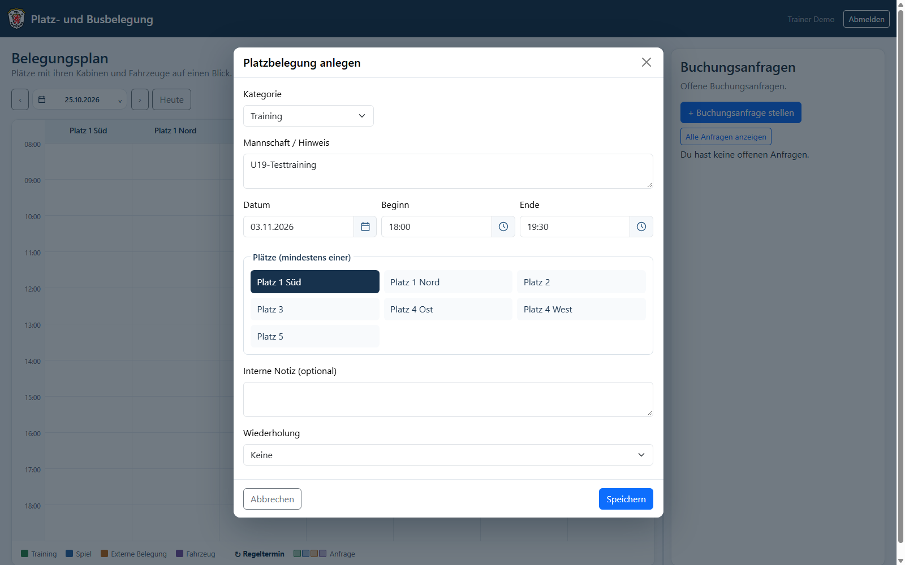
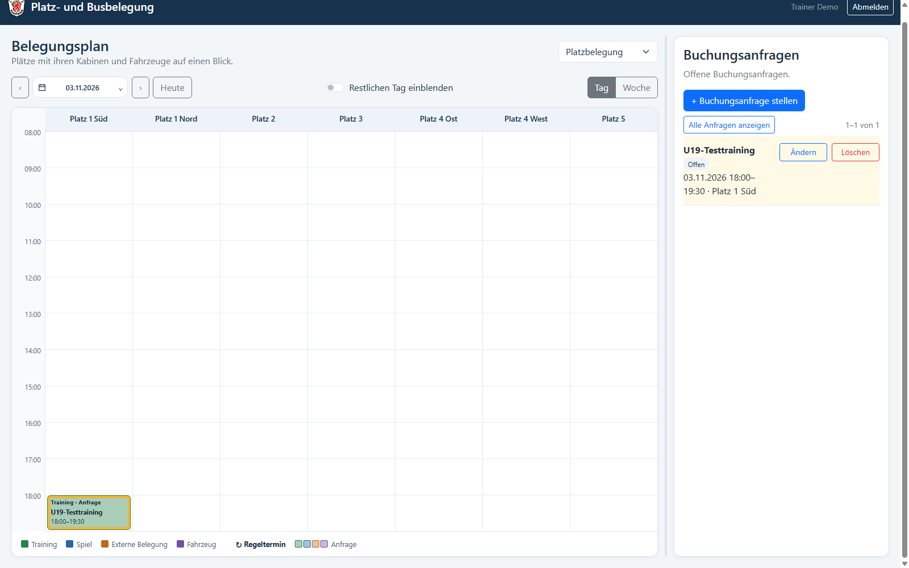
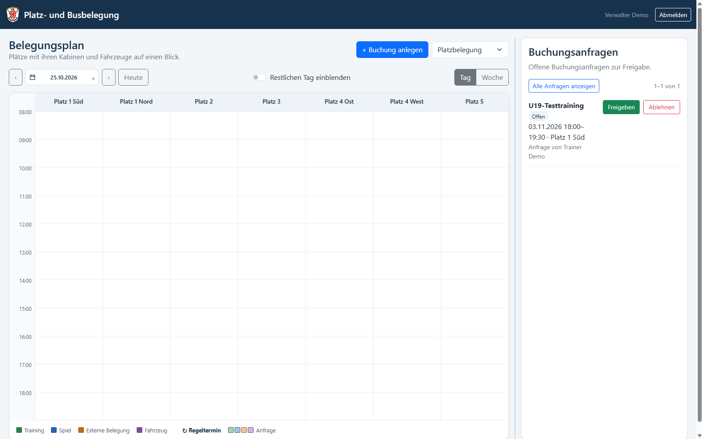
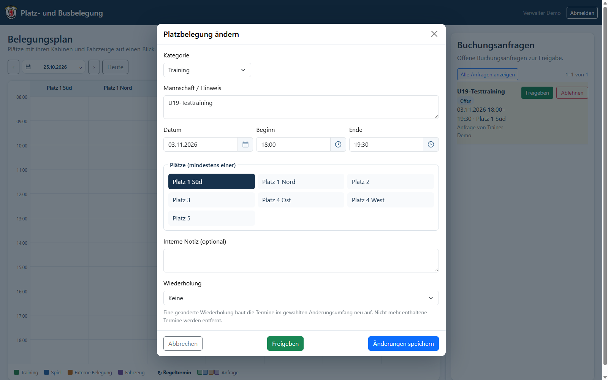
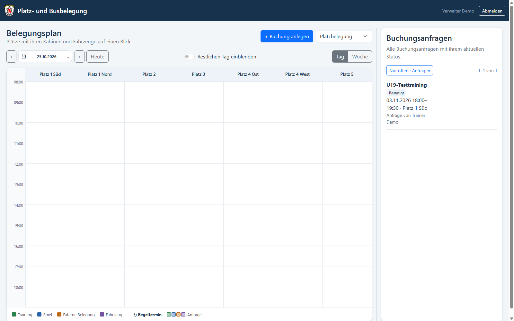
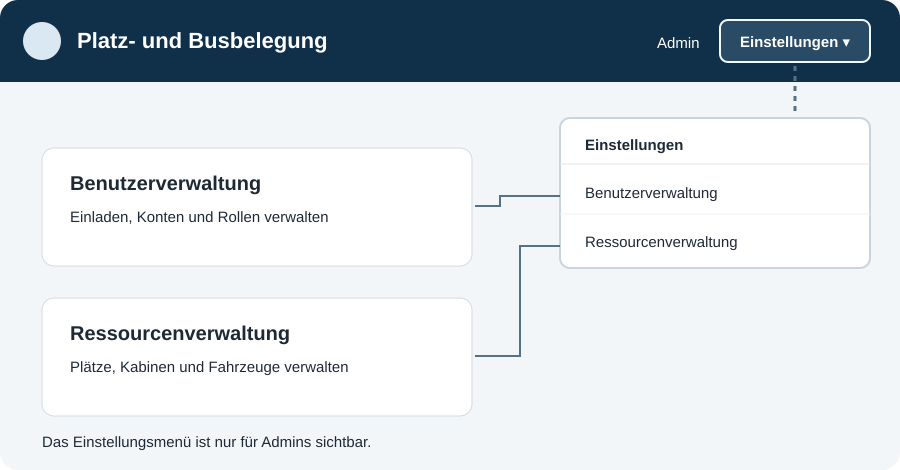

# Bedienungsanleitung: Platz- und Busbelegung

Diese Anleitung erklärt, wie der Belegungsplan im Alltag verwendet wird – vom Finden eines Termins über eine Buchungsanfrage bis zur Verwaltung von Benutzern und Ressourcen.

## Kapitel 1: Einführung und Motivation

Plätze, Kabinen und Fahrzeuge werden von mehreren Mannschaften und Verantwortlichen genutzt. Ein gemeinsamer Kalender macht Belegungen und offene Anfragen sichtbar und schafft einen einheitlichen Ablauf für Planung und Freigabe. Trainer können Termine anfragen, Verwalter können diese prüfen und genehmigen, und Admins verwalten zusätzlich Benutzer und Ressourcen.

Der Kalender ist eine Übersicht, keine automatische Konfliktprüfung: Zeitliche Überschneidungen sind möglich. Bitte prüfe vor dem Speichern die angezeigten Zeiten und Ressourcen.

Die Diagramme in dieser Anleitung sind **schematische Darstellungen**. Die Screenshots zum Anfrage- und Freigabeablauf zeigen die aktuelle Oberfläche mit fiktiven Demo-Daten; sie enthalten keine echten Buchungen oder Benutzerkonten. Beschriftungen oder Anordnungen können sich je nach Bildschirmgröße leicht unterscheiden.

## Inhaltsverzeichnis

1. Einführung und Motivation
2. Rollen und öffentliche Ansicht
3. Kalender bedienen
4. Buchungsanfrage stellen
5. Anfrage durch Verwalter prüfen und freigeben
6. Eigene Anfrage verwalten
7. Bestätigte Buchungen verwalten
8. Einstellungen für Admins
9. Häufige Fragen

## Kapitel 2: Rollen und öffentliche Ansicht

### Rollen im Überblick

| Rolle | Was du tun kannst |
|---|---|
| Öffentliche Besucher | Bestätigte Belegungen und offene Anfragen im Kalender ansehen. |
| Trainer | Platz- und Fahrzeuganfragen stellen sowie eigene offene Anfragen ändern oder löschen. |
| Verwalter | Buchungen direkt anlegen, Anfragen prüfen, genehmigen oder ablehnen und bestätigte Buchungen bearbeiten oder löschen. |
| Admin | Alle Verwalterfunktionen sowie Benutzer und Ressourcen verwalten. |

Die öffentliche Ansicht zeigt keine internen Notizen oder Fahrernamen. Diese Angaben sind Verwaltern und Admins vorbehalten.

### Öffentliche Ansicht (ohne Anmeldung)

Der Belegungsplan kann ohne Benutzerkonto geöffnet werden. Öffentliche Besucher können zwischen **Platzbelegung** und **Fahrzeugkalender** wechseln, den Zeitraum und die Tages- oder Wochenansicht auswählen und Kalendereinträge anklicken, um deren Details anzusehen.

Im Kalender erscheinen bestätigte Buchungen und offene Anfragen. Offene Anfragen sind als **Anfrage** gekennzeichnet und heller dargestellt. In den Details werden öffentliche Angaben wie Ressource, Kategorie und Zeitraum angezeigt; bei Fahrzeugbuchungen können auch Ziel und Zweck sichtbar sein. Fahrernamen und interne Notizen bleiben verborgen.

Die öffentliche Ansicht ist schreibgeschützt: Es gibt dort keine Anfrageübersicht und keine Möglichkeit, Buchungen anzulegen, zu ändern, freizugeben oder zu löschen. Dafür ist eine Anmeldung mit den passenden Berechtigungen erforderlich.

## Kapitel 3: Kalender bedienen

### Kalenderübersicht

### Kalender auswählen und navigieren

- Über das Kalender-Auswahlfeld wechselst du zwischen **Platzbelegung** und **Fahrzeugkalender**.
- Auf Handy und Desktop enthält das **Burger-Menü** rechts oben am Belegungsplan nur Ansichtseinstellungen. Radiobuttons wählen **Platzbelegung** oder **Fahrzeugkalender** sowie **Tag** oder **Woche**. **Restlichen Tag einblenden** bleibt eine Checkbox und ist nur in der Tagesansicht aktiv.
- Angemeldet öffnet der separate **+**-Button die Auswahl für neue Platz- oder Fahrzeugeinträge. Trainer stellen darüber Buchungsanfragen, Verwalter und Admins legen Buchungen an.
- Angemeldet öffnet ein Klick auf das Kopfsymbol neben deinem Namen das Benutzermenü mit **Mein Profil** und **Abmelden**. Admins finden dort zusätzlich **Ressourcenverwaltung** und **Benutzerverwaltung**. Ohne Anmeldung steht nur **Anmelden** zur Verfügung.
- Mit den Pfeilen wechselst du zum vorherigen oder nächsten Zeitraum. **Heute** springt zum aktuellen Datum; das Datum selbst öffnet die Datumsauswahl.
- **Tag** zeigt einen Tagesplan, **Woche** eine Wochenübersicht.
- Der Schalter **Restlichen Tag einblenden** zeigt bei Bedarf Zeiten außerhalb des Standardbereichs von 08:00 bis 19:00 Uhr.
- Ein Klick auf einen Kalendereintrag öffnet die Details. Dort siehst du unter anderem Kategorie, Ressourcen, Beginn, Ende, Wiederholung und – falls vorhanden – zugeordnete Kabinen.

Offene Anfragen sind im Kalender zusätzlich als **Anfrage** gekennzeichnet und heller dargestellt. Überlappende Buchungen können nebeneinander erscheinen.

### Anfrageübersicht anpassen

Die Anfrageübersicht befindet sich neben dem Kalender. Ziehe den Trenner zwischen beiden Bereichen, um die Breite zu ändern. Alternativ kannst du den Trenner mit den Pfeiltasten bedienen. Die Breite und die Auswahl zwischen Platz- und Fahrzeugkalender bleiben im aktuellen Browserfenster auch nach dem Neuladen erhalten.

## Kapitel 4: Buchungsanfrage stellen

Trainer erstellen eine **Anfrage**. Verwalter und Admins können eine Buchung direkt anlegen und bestätigen.

1. Öffne den **+**-Button rechts oben am Belegungsplan. Trainer stellen damit eine Buchungsanfrage, Verwalter und Admins legen eine Buchung an.
2. Wähle **Platzbelegung** oder **Fahrzeug**.
3. Fülle die Angaben aus und speichere.

### Anfrage absenden

Als Trainer prüfst du im Dialog Kategorie, Mannschaft oder Hinweis, Datum, Uhrzeiten und Ressource. Mit **Speichern** sendest du die Anfrage ab. Sie erscheint danach in deiner Übersicht als **Offen** und ist im Kalender als Anfrage markiert.

*Abbildung: Beispiel für eine ausgefüllte Trainingsanfrage vor dem Absenden.*

*Abbildung: Nach dem Absenden erscheint die Anfrage in der Liste und im Kalender.*

### 4.1 Angaben bei einer Platzbelegung

- Wähle eine Kategorie: **Training** oder **Spiel**. Verwalter und Admins können außerdem **Externe Belegung** auswählen.
- **Mannschaft / Hinweis** ist erforderlich.
- Wähle ein Datum, Beginn und Ende. Neue Buchungen starten mit 90 Minuten Dauer. Platzbuchungen müssen am selben Tag enden.
- Wähle mindestens einen Platz. Verwalter und Admins können zusätzlich Kabinen für den gesamten Buchungstermin zuordnen. Traineranfragen können keine Kabinen belegen.
- Optional kannst du eine interne Notiz ergänzen. Sie ist nicht öffentlich sichtbar.

### 4.2 Angaben bei einer Fahrzeugbuchung

Wähle das Fahrzeug und gib die erforderlichen Buchungsangaben ein, darunter **Mannschaft / Hinweis**, Zeitraum, Ziel, Zweck und Fahrer. Mehrtägige Fahrzeugbuchungen sind möglich. Fahrernamen und interne Notizen sind nur für Verwalter und Admins sichtbar.

### 4.3 Wiederholungen

Bei einer Platzbelegung kannst du eine Wiederholung festlegen: täglich, wöchentlich, monatlich oder jährlich. Je nach Regel lassen sich Intervall, Wochentage und Enddatum oder Anzahl der Termine einstellen. Eine Serie ist auf höchstens 5.000 Termine begrenzt.

## Kapitel 5: Anfrage durch Verwalter prüfen und freigeben

1. Öffne in der Anfrageübersicht den offenen Eintrag. Der Eintrag zeigt **Freigeben** und **Ablehnen**.
2. Prüfe die Angaben im Buchungsdialog und passe sie bei Bedarf an.
3. Wähle **Freigeben**, um die Anfrage mit den angezeigten Angaben zu bestätigen.

*Abbildung: Der Verwalter findet offene Anfragen in der Anfrageübersicht und kann sie dort öffnen oder direkt ablehnen.*

*Abbildung: Vor der Freigabe können die Angaben geprüft werden. Bei Bedarf lassen sie sich hier ändern.*

Bei Anfragen mit mehreren Plätzen betrifft die Freigabe alle noch offenen Platzzuordnungen des angezeigten Termins. Bei einer Serie werden genehmigte Termine in **Alle Anfragen** je Serie als ein Eintrag mit Anzahl und Zeitraum zusammengefasst. Offene Termine bleiben einzeln sichtbar.

Nach der Freigabe verschwindet der Eintrag aus der Liste der offenen Anfragen. Über **Alle Anfragen anzeigen** lässt sich der neue Status **Bestätigt** aufrufen.

*Abbildung: In der vollständigen Anfragenliste ist die genehmigte Anfrage als bestätigt gekennzeichnet.*

Mit **Ablehnen** lehnst du eine Anfrage ab. Die Anwendung fragt vorher in einem eigenen Dialog nach einer Bestätigung. Direkt von Verwaltern oder Admins angelegte Buchungen erscheinen nicht in der Anfrageübersicht; sie sind weiterhin im Kalender sichtbar.

## Kapitel 6: Eigene Anfrage verwalten

Die Anfrageübersicht zeigt standardmäßig deine offenen Anfragen. Wähle **Ändern**, um eine offene Anfrage im Buchungsdialog zu bearbeiten, oder **Löschen**, um sie zurückzuziehen. Vor dem Löschen erscheint eine Bestätigungsabfrage. Gelöschte offene Anfragen werden dauerhaft entfernt.

Mit **Alle Anfragen anzeigen** kannst du zusätzlich abgeschlossene Anfragen ansehen. Anfragen, deren Termine mehr als drei Monate zurückliegen, werden nicht angezeigt. Längere Listen sind seitenweise mit jeweils zehn Einträgen organisiert.

## Kapitel 7: Bestätigte Buchungen verwalten

Verwalter und Admins können einen bestätigten Kalendereintrag öffnen und bearbeiten. Bei Serienterminen fragt die Anwendung, ob die Aktion nur diesen Termin oder diesen und alle zukünftigen Termine betrifft. Prüfe den gewählten Umfang vor dem Speichern.

Zum Löschen wählst du im Termindialog **Löschen**. Bei Serienterminen wird zuerst der Umfang abgefragt, danach erscheint eine eigene Bestätigungsabfrage. Kabinen lassen sich ebenfalls aus der Buchung entfernen. Wird der letzte Platz eines Termins gelöscht, wird der Termin samt seinen Kabinenzuordnungen entfernt.

## Kapitel 8: Einstellungen für Admins

Admins öffnen über das **Kopfsymbol neben ihrem Namen** das Benutzermenü und wählen dort **Benutzerverwaltung** oder **Ressourcenverwaltung**. **Mein Profil** und **Abmelden** stehen allen angemeldeten Benutzern im selben Menü zur Verfügung.

### Benutzerverwaltung

- Benutzer per E-Mail einladen oder ohne E-Mail-Adresse anlegen.
- Beim Einladen und Anlegen werden Vor- und Nachname getrennt erfasst.
- Rollen und Kontostatus verwalten und Passwörter ändern.
- Beim Löschen eines Benutzers bleiben Buchungen und Buchungshistorie erhalten; die Zuordnung zum gelöschten Konto entfällt.

Der letzte aktive Admin kann nicht gelöscht werden.

Jeder angemeldete Benutzer kann über **Mein Profil** den eigenen Vor- und Nachnamen sowie die E-Mail-Adresse bearbeiten. Der Nachname ist optional. Der Benutzername wird dort angezeigt, kann aber nicht selbst geändert werden. **Abbrechen** führt ohne Speichern zurück zum Belegungsplan.

### Ressourcenverwaltung

- Plätze, Kabinen und Fahrzeuge anlegen, umbenennen, deaktivieren oder wieder aktivieren.
- Ressourcen innerhalb ihrer Kategorie per Drag-and-drop sortieren. Der Sortiergriff kann auch mit den Pfeiltasten bedient werden.
- Beim Löschen einer Ressource werden auch Buchungen entfernt, die sie verwenden. Prüfe deshalb vor dem Löschen, ob die Ressource noch benötigt wird.

Der Ressourcentyp einer bereits verwendeten Ressource kann nicht geändert werden.

## Kapitel 9: Häufige Fragen

**Warum sehe ich meine Anfrage nicht?**  
Prüfe, ob du angemeldet bist und ob **Alle Anfragen anzeigen** ausgewählt ist. Termine, die mehr als drei Monate zurückliegen, werden aus der Anfrageübersicht ausgeblendet.

**Warum sehe ich eine direkt angelegte Buchung nicht in „Alle Anfragen“?**  
Die Liste enthält Anfragen. Direkt angelegte Buchungen von Verwaltern und Admins erscheinen dort nicht, bleiben aber im Kalender sichtbar.

**Warum kann ich keine Kabine auswählen?**  
Kabinen können nur Verwalter und Admins einer Platzbuchung zuordnen. Traineranfragen können keine Kabinen belegen.

**Verhindert der Kalender Überschneidungen?**  
Nein. Zeitliche Überschneidungen sind möglich. Prüfe daher vor dem Speichern die Belegung und die ausgewählten Ressourcen.

**Wer sieht interne Notizen und Fahrernamen?**  
Nur Verwalter und Admins. Öffentliche Kalenderansichten geben diese Angaben nicht aus.
